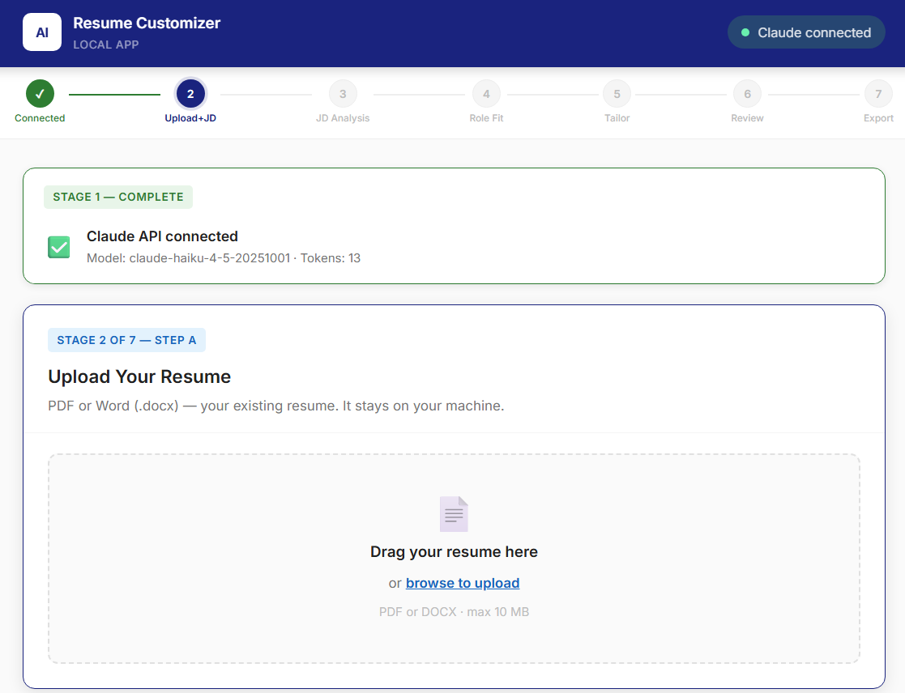
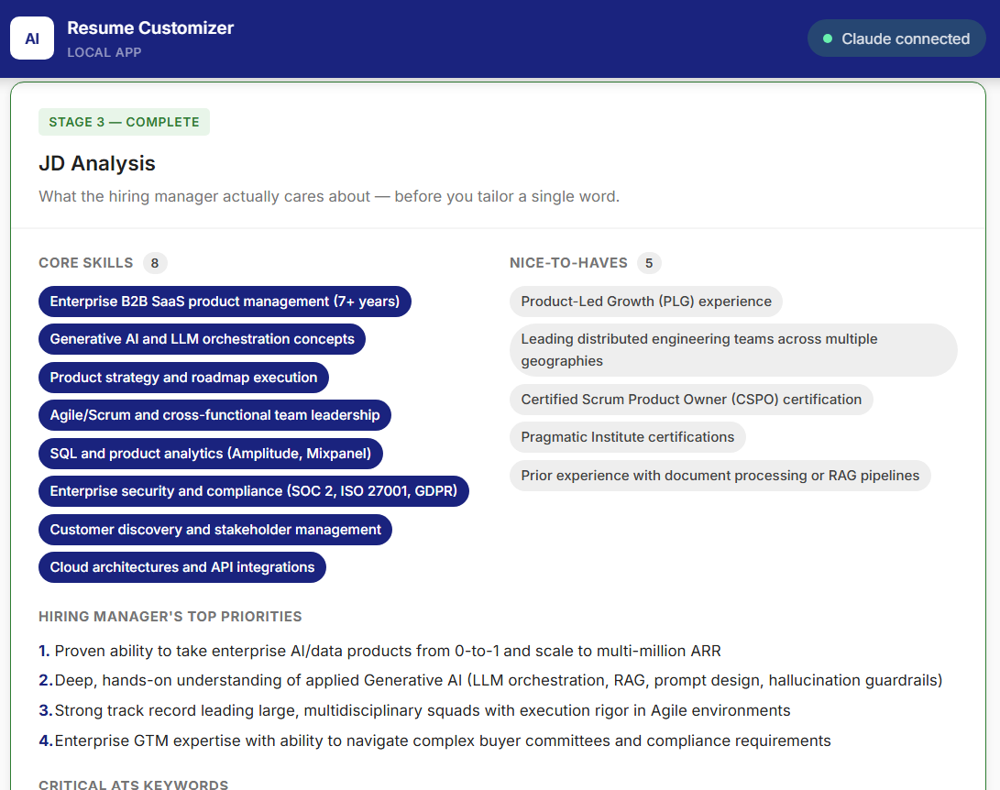
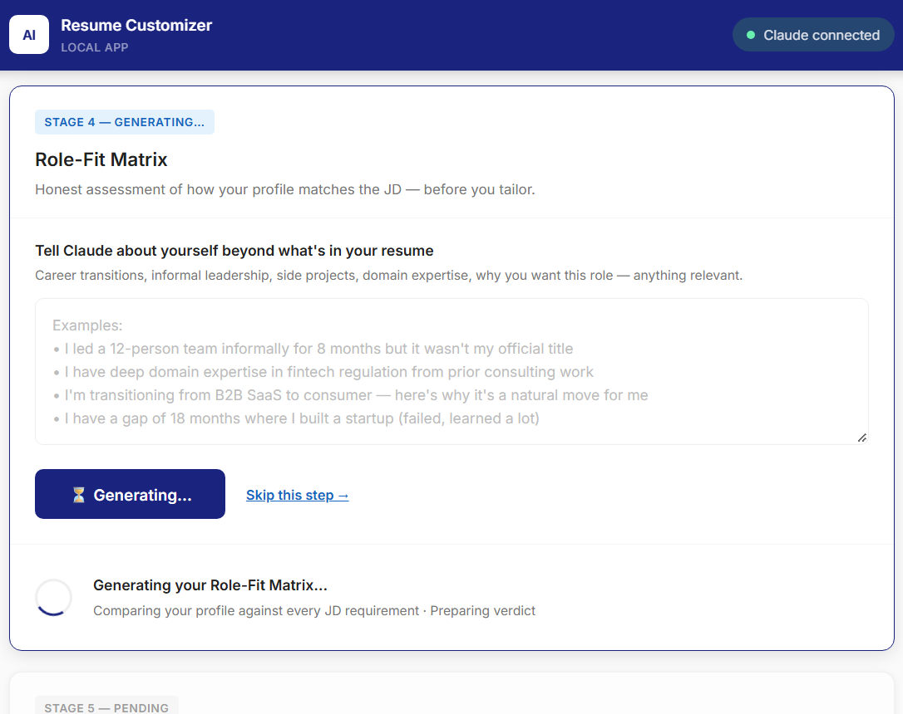
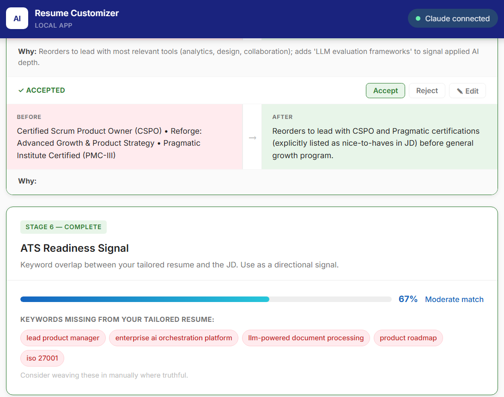

# AI Resume Customizer

> Upload your resume. Paste a job description. Let Claude rewrite every bullet for ATS and hiring manager fit. Export a clean, ATS-compliant DOCX — in under two minutes.

**Live demo:** https://ai-resume-customizer.onrender.com *(may take ~30 s to wake on first load — free tier)*

---

## Why I Built This

Tailoring a resume for every application is tedious and easy to get wrong. Most people either send the same generic resume everywhere, or spend an hour manually rewriting bullets — often missing the exact keywords the ATS is scanning for.

I built this to solve that problem for myself and a small group of colleagues. The app uses Claude (Anthropic's AI) as a structured resume coach: it reads the JD, maps your profile against it, rewrites every bullet with rationale, and exports a document that passes both the ATS scanner and the 10-second hiring-manager scan.

---

## Screenshots

| Stage | Screenshot |
|---|---|
| Upload resume + paste JD |  |
| JD Analysis — skills, priorities, ATS keywords |  |
| Role-Fit Matrix — honest assessment before tailoring |  |
| Review rewrites + ATS Readiness Signal |  |

---

## Features

- **7-stage guided workflow** — Connected → Upload+JD → JD Analysis → Role-Fit → Tailor → Review → Export
- **JD Analysis** — extracts core skills, nice-to-haves, ATS keywords, hiring manager priorities, and what to emphasise or downplay
- **Role-Fit Matrix** — a brutally honest skill-gap assessment before tailoring, so you know where you stand
- **Per-bullet rewriting** — every resume bullet is rewritten with an explanation of *why*; accept, reject, or manually edit each one
- **ATS Readiness Signal** — keyword-overlap score between your tailored resume and the JD, with a list of missing terms to weave in
- **ATS-compliant DOCX export** — contact block in the document body (not a Word header, which ATS parsers skip), sections reordered by relevance, LinkedIn as a live hyperlink
- **Session persistence** — progress saved to localStorage; refresh without losing your work
- **Input validation** — resume capped at 25,000 chars, JD at 15,000 chars; graceful error handling throughout
- **Basic Auth** — optional username/password protection for shared deployments

---

## Tech Stack

| Layer | Technology |
|---|---|
| Runtime | Node.js v24 |
| Framework | Express 4 |
| AI | Anthropic Claude API (`claude-haiku-4-5`) |
| DOCX generation | `docx` v8.5 |
| Resume parsing | `pdf-parse`, `mammoth` |
| File uploads | `multer` (memory storage) |
| Frontend | Vanilla JS, HTML5, CSS3 — no framework |
| Hosting | Render (free tier) |

---

## How It Works

The backend runs three separate Claude API calls, each with a purpose-built system prompt:

1. **`/api/analyse-jd`** — recruiter persona; extracts structured JSON (core skills, nice-to-haves, ATS keywords, hiring manager priorities, what to emphasise/downplay)
2. **`/api/role-fit`** — career coach persona; produces a requirement-by-requirement match matrix and a verdict on tailoring potential
3. **`/api/tailor`** — resume writer + ATS specialist persona; injects JD analysis context when available and returns per-bullet rewrites with rationale

The frontend is a single-page app with a gateway phase state machine (`idle → ready → jd-done → fit-done → tailored → exported`) that controls what actions are available at each step.

DOCX export auto-extracts email, phone, LinkedIn, and location from the raw resume text using regex and pattern matching, then renders a body-first contact block and reorders sections by relevance (Summary → Skills → Experience → Education → Certifications → ...).

---

## Local Setup

### Prerequisites
- Node.js 18+ (tested on v24)
- An [Anthropic API key](https://console.anthropic.com)

### Steps

```bash
# 1. Clone the repo
git clone https://github.com/arkhamknight147/ai-resume-customizer.git
cd ai-resume-customizer

# 2. Install dependencies
npm install

# 3. Set up environment variables
cp .env.example .env
# Open .env and add your ANTHROPIC_API_KEY

# 4. Start the dev server
npm run dev
# App runs at http://localhost:3000
```

---

## Environment Variables

| Variable | Required | Description |
|---|---|---|
| `ANTHROPIC_API_KEY` | Yes | Your key from [console.anthropic.com](https://console.anthropic.com) |
| `AUTH_USER` | No | Username for HTTP Basic Auth (production only) |
| `AUTH_PASS` | No | Password for HTTP Basic Auth (production only) |

Copy `.env.example` to `.env` and fill in values. **Never commit `.env` — it is gitignored.**

---

## Deployment (Render)

1. Push this repo to GitHub
2. Create a new **Web Service** on [render.com](https://render.com), connect the repo
3. Set **Build Command**: `npm install`  |  **Start Command**: `npm start`
4. Add environment variables in the Render dashboard (no quotes around values)
5. Deploy — Render provides a free `*.onrender.com` URL

---

## Project Structure

```
.
├── public/
│   ├── index.html      # Single-page app shell + all 7 stage cards
│   ├── app.js          # State machine, API calls, session persistence
│   └── style.css       # CSS variables, card layout, progress bar
├── docs/
│   └── screenshots/    # Screenshots used in this README
├── .env.example        # Template — copy to .env and fill in secrets
├── .gitignore
├── package.json
├── README.md
└── server.js           # Express server, Claude API integration, DOCX export
```

---

## Potential Improvements

- [ ] Streaming Claude responses for real-time bullet generation
- [ ] Support for multiple job descriptions (comparison mode)
- [ ] Cover letter generation using the same JD analysis
- [ ] User accounts with saved tailoring history
- [ ] Google Docs export option

---

## Author

Built by [Nishant Kanhurkar](https://www.linkedin.com/in/nishant-kanhurkar) — Product Manager with a habit of building the tools he wishes existed.

---

## License

MIT
